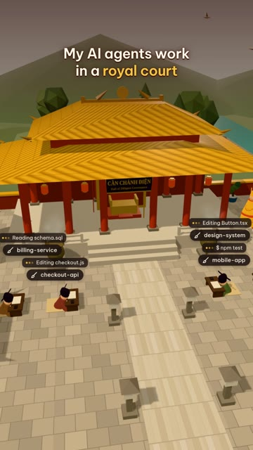

# Grand Secretariat

**Your Claude Code agents, at work in a royal court.**

Grand Secretariat is a local web app that runs your Claude Code agents and shows each one as a scribe in a 3D court of Huế. You see at a glance who is working, who needs you and who is done, and you talk to any of them in its own terminal without leaving the page. No more "open a terminal, `cd` into the repo, type `claude`".

<p align="center">
  <a href="docs/media/grand-secretariat-promo-en.mp4">
    
  </a>
  <br>
  <sub><a href="docs/media/grand-secretariat-promo-en.mp4">▶ Watch the 35-second promo (English, with sound)</a></sub>
</p>

## What you get

- **One figure per agent.** Each scribe is a real `claude` session in its own terminal, held by the server. Click a figure, its name chip or its row in the rail to open its live terminal in the dock.
- **Who needs you, at a glance.** A scribe that asks a question runs to the throne and kneels with a yellow petition, with the question on it. One that finished its turn stands there with a jade tablet. The browser tab counts how many are waiting. Busy? Send it back to its desk from the dock: it sits there with a bubble over its head, still waiting, until you call it to the throne again.
- **Summon with the drum.** Strike the drum pavilion, pick a repository (or any folder), name the ticket, give a first order. Start a new conversation, continue the last one, or resume an old one.
- **Sub-agents are soldiers.** Every sub-agent a scribe sends out rises from a golden seal, stands in ranks behind its master and reports back with a bow.
- **Ink level.** Each scribe shows how full its context is (`~62% ink`), read from its own transcript, plus its token count.
- **Annals and History.** The Annals give a per-day chronicle of every scribe: orders, files changed, commits, time spent waiting on you. History lists dismissed scribes so you can recall one with its conversation.
- **A living court.** The king walks the hall, egrets land on the roofs, koi swim in the lotus pond. The court has sound, all synthesized in the browser: a drum when you summon, a gong for a petition, a bell for a report, đàn tranh music in the background. Every sound can be switched off.
- **Survives restarts.** Stop the server and start it again: each scribe comes back in its place and resumes its conversation.
- **Light on your machine.** The court redraws only as often as something moves, and goes still while you type. A power saver mode turns off the background life.

## Six worlds

Pick one from the globe button at the foot of the rail:

| World | Agents are | Sub-agents are |
|---|---|---|
| **Huế court** (default, 3D) | scribes at their desks | soldiers |
| **Huế court (pixel 2D)** | the same court in isometric pixel art | soldiers |
| **Zoo** | cartoon animals at their feeding troughs | cubs |
| **Modern office** | employees at glass-walled desks | contractors with laptops |
| **Space station** | crew at consoles above a planet | hover drones |
| **Order rail** (web board, no 3D) | order dockets on a kitchen rail, in stations by what they need | prep cooks |

## Quick start

Requires Node 22+, Claude Code (`claude`) on your PATH, and `curl`.

```bash
npm install
npm run dev        # open http://127.0.0.1:4777
```

Production and desktop install:

```bash
npm run build && npm start   # serves the built app
npm run install-app          # Ubuntu: starts at login, adds an app-menu launcher (http://grand-secretariat.localhost:4780)
npm run update               # rebuild and restart after a change
```

Agents start with plain `claude`. If the `ccs` account switcher is installed, it is used instead and its accounts show up as profiles in the summon form. Settings (port, repository root, flags, …) are environment variables, listed in the [deployment guide](docs/deployment-guide.md#environment-variables).

## Keyboard

| Keys | Does |
|---|---|
| `Alt+↓` / `Alt+↑` | Open the next / previous scribe (waiting ones first) |
| `Alt+W` | Open the scribe that has waited on you longest |
| `` Alt+` `` | Close the dock, or reopen the last scribe |

In the 3D worlds, left drag pans, right drag or the wheel zooms, and middle drag turns the view. On a phone or tablet, drag in the terminal to scroll it.

## How it works

Each agent runs as `claude --dangerously-skip-permissions --settings <hooks file> --session-id <id>` in the chosen repository, inside a PTY owned by a small Node server. Claude Code's hooks post every lifecycle event back to the server, which turns it into a status the court acts out:

| Claude Code event | Status | In the court |
|---|---|---|
| `SessionStart` | idle | seated, still |
| `UserPromptSubmit`, tool use | working | writing at the desk, current step shown over its head |
| `AskUserQuestion`, `ExitPlanMode`, permission prompt | asking | kneels before the throne with a petition |
| `Stop` | done | stands before the throne |

The browser draws the court with three.js and connects to each terminal over a WebSocket (xterm.js). See [system architecture](docs/system-architecture.md) for the full picture.

## Security

Agents run with permissions skipped, so the server is locked down to you:

- it listens on `127.0.0.1` only and rejects any `Host` or `Origin` that is not its own;
- every API call and terminal needs an access token kept in the state folder (mode 0600);
- the only supported remote access is `tailscale serve`, limited to your own Tailscale login (`scripts/tailscale-serve.sh`, see the [deployment guide](docs/deployment-guide.md#access-from-your-other-devices-tailscale)).

Do not expose the port any other way.

## Documentation

| Document | Contents |
|---|---|
| [Project overview](docs/project-overview-pdr.md) | Purpose, users, requirements |
| [Deployment guide](docs/deployment-guide.md) | Running, installing, environment variables, state folder, Tailscale |
| [System architecture](docs/system-architecture.md) | Components, data flow, status model, security model |
| [Codebase summary](docs/codebase-summary.md) | Every file and its role |
| [Code standards](docs/code-standards.md) | Structure, naming, error handling, security rules |
| [Design guidelines](docs/design-guidelines.md) | Design system summary ([DESIGN.md](DESIGN.md) is the source of truth) |
| [Project roadmap](docs/project-roadmap.md) | Done, known gaps, next steps |
| [`promo-video/`](promo-video/) | Kit that records the promo video with fake agents |

## License

[MIT](LICENSE) © 2026 quangtdev
