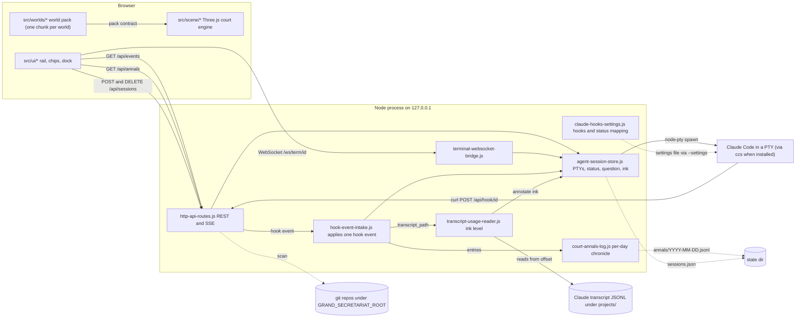
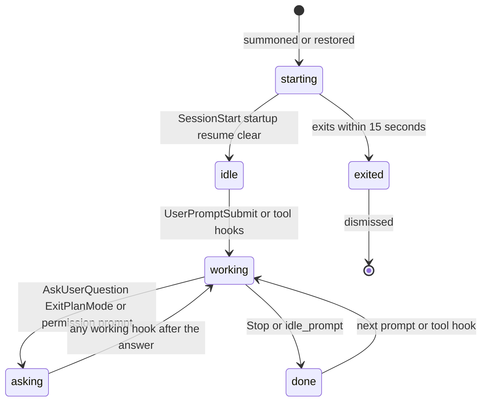
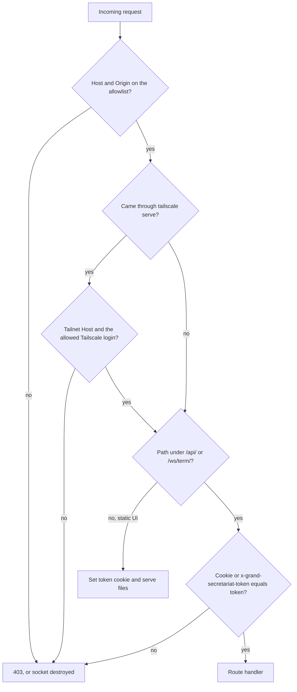

# System Architecture

Last updated: 2026-11-14. Describes branch `feat/ink-annals-idle-scribes` at `a505ed6`, on top of `ddcdbd7` (world packs, the world picker, the isometric 2D camera, the pixel Huế court, the power saver). This branch adds the ink level and the court annals, both fed by the hook events.

One Node process runs the HTTP API, the terminal WebSocket bridge, and the web UI (Vite middleware in dev, `sirv` over `dist/` in production). The same process owns one pseudo-terminal (PTY) per agent. The browser renders those agents as a court (the 3D Huế court by default, or an isometric pixel court; see [World packs and boot](#world-packs-and-boot)), shows what each is doing in the rail, the chips and the dock, and streams the real terminal of the one the user opens.

## Contents
- [Components](#components)
- [World packs and boot](#world-packs-and-boot)
- [Data flow](#data-flow)
- [Status model](#status-model)
- [Persistence and restore](#persistence-and-restore)
- [Dock and shortcuts](#dock-and-shortcuts)
- [Court scene](#court-scene)
- [Desks on demand: the porter crew](#desks-on-demand-the-porter-crew)
- [Render cost governor](#render-cost-governor)
- [Living court: orders, edicts and the king](#living-court-orders-edicts-and-the-king)
- [Security model](#security-model)
- [Failure modes](#failure-modes)

## Components

| Module | Responsibility | Lines |
|---|---|---|
| `server/index.js` | Entry point. Access token, Vite or `sirv`, request routing, `SIGINT`/`SIGTERM` handling | 83 |
| `server/config.js` | All env-var configuration and fixed constants | 60 |
| `server/agent-launcher-detection.js` | Chooses `ccs` and its profiles, or plain `claude`, when nothing is configured | 41 |
| `server/agent-session-store.js` | Agent records, PTY lifecycle, scrollback, status, activity, question, state file; `annotate()` for observer data (ink); `left` event | 300 |
| `server/claude-hooks-settings.js` | Writes the hooks settings file; maps hook events to status | 80 |
| `server/hook-activity-description.js` | Maps hook events to the order, the current step and the question | 106 |
| `server/subagent-soldier-tracker.js` | Sub-agents (soldiers) per agent, from hook events | 112 |
| `server/http-api-routes.js` | `/api/*` routes, Host/Origin and token checks, SSE feed, `GET /api/annals`; the hook route hands each event to `hook-event-intake.js` | 164 |
| `server/hook-event-intake.js` | One hook event: applies it to the store, then gives it to the ink reader and the annals log (fire-and-forget) | 48 |
| `server/transcript-usage-reader.js`, `server/transcript-usage-parse.js` | Ink level: reads each scribe's transcript from its last offset (async, 1 MB chunks), keeps the context and token totals; the parser is pure | 124, 59 |
| `server/court-annals-log.js`, `server/court-annals-events.js` | Annals writer: one JSONL file per local day, queued writes, pruning; the pure rule for which hook events are worth a line | 65, 66 |
| `server/court-annals-summary.js`, `server/court-annals-reader.js` | Annals reader: one day's lines to a per-scribe chronicle (pure), and `GET /api/annals` with the day checks | 76, 54 |
| `src/ui/ink-level-text.js`, `src/ui/court-annals-text.js` | Pure wording for the ink level (`~62% ink`) and the annals (counts, wait, day label), shared by every world | 30, 40 |
| `src/ui/court-annals-panel.js` | Dock view of the annals: one day, grouped by scribe, day arrows | 81 |
| `server/terminal-websocket-bridge.js` | `/ws/term/<id>` upgrade, I/O between socket and PTY | 48 |
| `server/repository-scanner.js` | Finds git repositories (4 levels deep, 30 s cache) | 51 |
| `src/main.js` | Composition root: loads the chosen world, wires the feed to the scene, chips, roster, dock, audio, the power saver and the living court; the Alt shortcuts; the frame loop | 355 |
| `src/worlds/world-registry.js`, `src/worlds/world-pack-contract.js` | Which worlds exist, the saved and URL choice, lazy loading; what a world must supply, and the dev check | 73, 188 |
| `src/worlds/<id>/` | One folder per world: its stage, costumes, sprites and background life. See the [codebase summary](./codebase-summary.md#worlds-srcworlds) | see codebase summary |
| `src/ui/terminal-panel.js` | Dock: tabs, header, activity strip, terminal; detects typing and submitted orders | 253 |
| `src/ui/dock-activity-strip.js`, `dock-agent-tabs.js`, `dock-shortcuts.js` | The dock's one-line status, its tab strip, and the Alt keys | 51, 35, 31 |
| `src/ui/overhead-chips.js` | Chips and their toasts; placement without overlap | 157 |
| `src/ui/world-picker.js`, `src/ui/power-saver-toggle.js` | Rail-foot globe (choose the world) and leaf (power saver) buttons | 80, 48 |
| `src/scene/court-scene.js`, `src/scene/court-camera-rig.js` | Renderer, the world's lights, fog and shadows, pixel ratio, frame loop; the perspective or isometric camera | 135, 133 |
| `src/scene/render-cost-governor.js` | Frame-rate tiers (the world's and the power saver's), shadow timing and frame pacing | 167 |
| `src/scene/agent-figure-motion.js`, `ruler-figure-motion.js`, `humanoid-pose-animator.js` | Figure behaviour: walking, poses, bows, the king's movement; no costume | 138, 120, 36 |
| `src/scene/sprite-figure-body.js`, `src/scene/sprite-body-animators.js` | Sprite figures of the 2D worlds: one plane per figure, clip choice, alpha-aware picking | 165, 79 |
| `src/scene/desk-porter-crew.js` | Carries desks out on summon and away on dismiss | 227 |
| `src/scene/camera-focus-ease.js` | Glides the view to an opened scribe and back | 77 |
| `src/scene/king-stroll-routine.js` | When the king strolls, hurries back, or stays seated | 148 |
| `src/audio/court-audio.js` | Sound engine: cue timing, typing murmur, Sounds and Music toggles; the sounds come from the world pack | 154 |
| `src/api-client.js` | `fetch` and `EventSource` wrappers | 45 |
| `src/status-vocabulary.js` | Status labels, icons, throne flag, `waitingFirst()` (shared by all UI) | 94 |
| `server/folder-browser.js` | Lists sub-folders for the summon form's Browse panel and validates a chosen folder | 39 |

Full file list: [codebase-summary.md](./codebase-summary.md).

## World packs and boot

A world pack dresses the court. The engine (motion, layout, frame loop, UI) behaves the same in every world. Each world is one folder in `src/worlds/`, registered in `world-registry.js`, and built by Vite as its own chunk, so the other worlds' code is not downloaded.

### Pack contract

The typedefs are in `src/worlds/world-pack-contract.js`. The engine uses:

| Member | Used for |
|---|---|
| `id`, `label` | The `?world=` value and saved choice; the picker's label |
| `environment` | Background and fog colour, `hemi`, `sun` and `rim` lights, `shadows` (a power saver cannot turn it on), `camera` (`perspective`, or `orthographic` with `view: 'isometric'`, `zoom`, integer `pixelScale`, optional `fps`) |
| `palette` | Five colours the engine draws itself: `ring`, `pool`, `portalSummon`, `portalDismiss`, `edictTrail` |
| `buildStage(scene, hooks)` | Returns `{ summonTarget, summonAnchor, ambient }`. Each `ambient` item has `update(dt, time)` and optional `settle(petition)`; the list is skipped under the power saver |
| `audio` | The world's sound: `createInstruments(ctx, {dry, wet})`, `createReverb(ctx, destination)`, `cues` (eleven `(play, t)` scores: call, summon, petition, report, failed, muster, disband, edict, chirp, desk, depart), `Ambience` (music class with `start()`, `stop()`, `playing`), `murmur(play, t)`. `CourtAudio` (`src/audio/court-audio.js`) keeps timing, preferences, unlock, cue gap and resting the engine |
| `vocabulary` | Every user-visible word: `agent` and `helper` nouns with `{ one, many }`, state labels, optional `icons` override, rail, summon, history and dock text. Installed with `setVocabulary()` (`src/worlds/world-vocabulary.js`) before any UI is built; UI modules read the live `words` object. Full key list: `hue-court/hue-court-vocabulary.js` |
| `bodies` | Factories: `agent(session)`, `ruler()`, `helper(soldier, masterId)`, `porter()`, `workplace(slot)`, `edictProjectile()`. A body draws and animates; the engine owns walking, queueing, bowing and desks carried out |

Positions (desks, throne, petition spots, paths, the drum pavilion) come from `src/scene/court-layout.js`, not from a pack. Every world puts things in the same places. One optional pack field, `petitionSpacing` (default 1.3), widens the gap between petitioners; the pixel court sets 3 so kneeling figures with raised scrolls do not overlap on screen. Another, `desks` (a list built with `makeDeskSlot`), replaces the shared desk grid, which collapses in the isometric view; the pixel court spaces eight desks so that six scribes with a soldier each stand apart. Bodies may set `scale` (king, soldier, porter as well as scribe); the sprite bodies use 1, so every art pixel is the same size.

### Boot flow (`src/main.js`)

1. `selectedWorldId()` reads `?world=<id>`, then the saved choice (`grand-secretariat:world` in `localStorage`), then the default `hue-court`. Unknown ids fall back to the default.
2. `loadWorld(id)` imports the chunk. If the import fails, a non-default world is logged, its saved choice is forgotten and the default loads in place. If the default fails, boot stops.
3. In dev only (`import.meta.env.DEV`), `assertWorldPack()` throws one error naming every missing or mistyped member.
4. `createCourtScene()` builds the renderer and camera. `buildStage()` runs and `assertWorldStage()` checks its result. Each body factory is called once and disposed, so a broken body fails at boot, not at the first agent.
5. If step 4 throws, a non-default world is logged, forgotten, and the page reloads into the default (`resetToDefaultWorld()`, which also drops `?world=`). A failing default world stops boot.
6. `setVocabulary(world.vocabulary)` installs the words, and `applyVocabularyToPage()` replaces the static text of `index.html` (title, rail and stage labels, the stage hint chosen by camera type). `index.html` keeps the Huế text as its pre-boot default. `CourtAudio` is built from `world.audio`.

UI colours: an inline script in `index.html` sets `<html data-world="<id>">` before first paint (same `?world=` and saved choice as the registry; its short id list must match `WORLDS`). `src/styles/world-themes.css` holds one `:root[data-world=...]` block per world that overrides existing tokens; the Huế worlds have none. Status colours (glaze yellow = asks, jade green = done, danger red) never change between worlds.

The user switches worlds from the globe button in the rail foot (`src/ui/world-picker.js`). A different choice is saved and the page reloads. `?world=` wins over the saved choice for one visit; if the browser refuses storage, the choice travels in the URL instead.

## Data flow

### Summon
1. The user submits the summon form. The browser POSTs JSON to `/api/sessions`.
2. The route rebuilds the repository list and rejects any `repo` path that is not in it. It also checks `profile` against `GRAND_SECRETARIAT_PROFILES`, clips the ticket to 60 characters, and clips the order to 8000 characters.
3. `AgentSessionStore.create()` assigns a UUID and spawns the launcher (`claude`, or `ccs` when installed) in the repository with `node-pty`. The argument list is passed as an array, never through a shell.
4. The store persists the state file and emits `change`.
5. Every open SSE response receives the full agent list (`broadcast()`).
6. The browser opens that agent's terminal once its id appears in the feed, and its porters carry its desk out (see [Desks on demand](#desks-on-demand-the-porter-crew)).

### Status, activity and question from hooks
1. Each agent's settings file registers six hooks: `SessionStart`, `UserPromptSubmit`, `PreToolUse`, `PostToolUse`, `Notification`, `Stop`. Each runs `curl` with the agent's `GRAND_SECRETARIAT_ID` and token, and ignores failures.
2. `POST /api/hook/<id>` calls `handleHookEvent()` (`server/hook-event-intake.js`), which runs `noteHookEvent()` (resume bookkeeping), then:
   - `statusFromHookEvent()` sets the status. A sub-agent's event (one with `agent_id`) does not change the status while its master is asking, so a soldier still at work cannot lift the petition.
   - If the agent is asking, `questionFromHookEvent()` gives the question (80 characters at most), and `setQuestion()` stores it. A notification never replaces a question already set by `AskUserQuestion`.
   - For the agent's own events only, `activityFromHookEvent()` and `orderFromHookEvent()` set the step and the order.
   - `applySoldierHook()` updates the sub-agents.
3. `setStatus()`, `setQuestion()` and `setActivity()` emit `change` only when the value changes. The SSE feed then pushes the new list.
4. After the store is updated, two observers get the event. Both are fire-and-forget: the hook's reply (`200`) never waits for them, and an observer error is logged and not thrown.
   - Annals: `annalsEntriesFromHook()` decides which lines the event is worth, and `CourtAnnalsLog.append()` writes them (see [Court annals](#court-annals)).
   - Ink: the event's `transcript_path` is remembered for the scribe, and a transcript read is scheduled (see [Ink level](#ink-level)). A `Stop` event reads at once.

### Feed fields
`store.list()` is the feed. It includes `activity` and `order` only while the agent is `working`, `question` only while it is `asking` (otherwise `null`), and `soldiers` (each with its task, kind and step). It includes `ink` only once the transcript has an assistant turn: `{used, limit, pct, totals}`, where `pct` is 0 to 100, `limit` is 200 000 or 1 000 000 (or the env override), and `totals` holds `input`, `output`, `cacheRead` and `cacheWrite` for the session.

### Ink level
The ink level is the context an agent's conversation holds now, and the tokens its session has used. It is text only: `~62% ink` in the rail row and the dock strip, the words set by each world (ink, context, appetite or fuel). It never changes colour, and from 85% only the wording changes.

1. The transcript path comes from the scribe's own hook payloads (`transcript_path`). The reader accepts only an absolute `.jsonl` file whose real path is under the Claude Code `projects` folder (`$CLAUDE_CONFIG_DIR`, `~/.claude` or a ccs profile in `~/.ccs/instances/<profile>`), so it never reads elsewhere, and a sub-agent's events are ignored.
2. Reads are async and start from the last byte read. A chunk is 1 MB and the reader yields to the event loop between chunks. Reads are throttled to one per 2 seconds per scribe, and a `Stop` reads at once.
3. Context used is `input + cache read + cache creation` of the last main-chain assistant turn (`message.usage`). Token totals count each streamed message once, by `message.id`. Synthetic and sidechain lines are skipped.
4. The limit is 200 000. It latches to 1 000 000 once more than 200 000 was seen, because transcripts do not record the `[1m]` model suffix. `GRAND_SECRETARIAT_CONTEXT_LIMIT` overrides both.
5. Tokens already in a transcript when it is first read are history: they are baselined, not reported. The exception is a conversation whose `SessionStart` (source `startup` or `clear`) the server saw: it is new, so every token in it is spend. At each `Stop`, the tokens spent since the last report go to the annals as one `tokens` line.
6. On `/clear` the conversation moves to a new transcript path. The reader clears the scribe's ink (`null`) and starts that transcript from zero until it has an assistant turn.

### Court annals
The annals are a per-day chronicle of the court, kept on disk, and shown in the dock's Annals panel.

Storage: `<state>/annals/YYYY-MM-DD.jsonl`, one line per record, days by server local time. The folder is 0700 and the files 0600. Files older than `GRAND_SECRETARIAT_ANNALS_DAYS` (30 by default) are deleted at start and then once a day. Summaries are computed on read; nothing is summarised on disk.

| `kind` | Written when | Fields |
|---|---|---|
| `order` | A real prompt is sent (not a task notification, not a sub-agent's) | `text`: first 200 characters, flattened |
| `file` | `Edit`, `Write`, `MultiEdit` or `NotebookEdit` finishes | `path`: relative to the scribe's repository when inside it |
| `commit` | A `git commit` finishes without an error or a dry run, and its message can be read | `msg`: from the `[branch sha] message` summary, else the `-m` text (200 characters); a heredoc message that is not in the output is not logged |
| `throne` | The status enters or leaves `asking` or `done` | `status`, and `enter: true` or `leave: true` |
| `tokens` | At each `Stop`, when the transcript shows new spend | `input`, `output`, `cacheRead`, `cacheWrite` (the delta) |
| `left` | The scribe leaves the court | none; the server writes it from the store's `left` event |

Every record has `t` (milliseconds), `id`, `ticket`, `repo` and `kind`.

`GET /api/annals?day=YYYY-MM-DD` answers the day's chronicle, grouped by scribe, with `prevDay`, `nextDay` and `today`. With no `day`, the answer is today, or the latest earlier day with records when today has none yet (the morning view). The day must be a real calendar date, or the answer is 400. A day with no file gives an empty list; a day file over 5 MB answers 413.

The summary caps the lists it returns (200 orders, 50 files, 100 commits) and carries the full counts (`orderCount`, `fileCount`, `commitCount`). A throne wait is the time between an `enter` and its `leave`; a wait still open when the day is read ends at the day's end or at now. A wait that runs past midnight or across a server restart is counted only up to the end of the day it began: the next day has its `leave` but no `enter`, so it does not count that part.

### Terminal
1. The dock opens `ws://<host>/ws/term/<id>`. The upgrade needs a trusted Origin and the access token.
2. The server sends the scrollback replay as one text frame, then streams PTY output as text frames.
3. Client to server messages are JSON: `{t:'i', d}` for input and `{t:'r', c, r}` for resize (cols clamped to 20 to 400, rows to 5 to 200).

## Status model

| Status | Set by | Rail group | Court place | Pose | Icon | Label |
|---|---|---|---|---|---|---|
| `starting` | store, at spawn | At their desks | desk (walks in from the entrance) | seated | `arrive` | Arriving |
| `idle` | `SessionStart` with source `startup`, `resume` or `clear` | At their desks | desk | seated | `wait` | Awaiting orders |
| `working` | `UserPromptSubmit`, `PreToolUse`, `PostToolUse` | At their desks | desk | seated, brush in hand | `brush` | Working |
| `asking` | `PreToolUse` of `AskUserQuestion` or `ExitPlanMode`; `Notification` of type `permission_prompt` or `elicitation_dialog`, or text matching permission/approval/"needs your" | Before the throne | petition ground | kneeling, scroll raised | `scroll` | Needs your ruling |
| `done` | `Stop`; `Notification` `idle_prompt` only while `working` | Before the throne | petition ground | standing, jade tablet | `seal` | Reporting back |
| `exited` | process exits within 15 s of start and was not dismissed | Before the throne | petition ground | seated (no distinct pose) | `close` | Failed to start |

Rules that the table does not show:
- A live agent whose process exits after 15 seconds is removed from the court, not marked `exited`.
- `exited` agents are never written to the state file.
- `SessionStart` with source `compact` (mid-turn) does not reset to `idle`.
- `idle_prompt` after an Esc interrupt is the only signal that ends `working` when no `Stop` fires.
- `setStatus()` ignores agents whose process is gone.
- `question` is cleared as soon as the status leaves `asking`.
- The roster and the petition queue order by `statusSince`, oldest first.

**What each status shows, by place:**
- **Working:** the step (from `activityFromHookEvent()`, 48 characters; `UserPromptSubmit` sets `Reading the order`; before any step is known it says `Thinking`) in the chip's toast, the rail's second line and the dock's activity strip. The order (first line of the prompt, 56 characters) and the soldiers show on hover or when the chip is open. Blocking tools, `Stop`, `SessionStart` and `Notification` clear the step; `PostToolUse` keeps the last one.
- **Asking:** the question in the toast, the rail's second line and the dock's activity strip (the strip turns glaze). With no question known, the status label stands in.
- **Done, idle, failed:** the status label. No toast step.

## Persistence and restore

Location: `<STATE_DIR>` (default `~/.local/state/grand-secretariat`, see [deployment-guide.md](./deployment-guide.md)).

| File | Written when | Content |
|---|---|---|
| `sessions.json` | On every agent change; atomic (`.tmp` then rename), mode 0600 | Saved fields: `id`, `ticket`, `repo`, `profile`, `mode`, `createdAt`, `hasConversation`, `claudeSessionId` |
| `history.json` | When an agent with a conversation leaves, or an entry is recalled/forgotten; atomic, mode 0600 | Same fields as `sessions.json` plus `leftAt`; newest first, max 50 |
| `sessions.json.bad` | A corrupt state file is renamed here, not overwritten | Kept for manual recovery |
| `access-token` | First start, or if the file is shorter than 32 characters | 32 random bytes as hex, mode 0600 |
| `agent-hooks-settings.json` | Every server start | Hook definitions passed to agents with `--settings` |
| `annals/YYYY-MM-DD.jsonl` | Each annals record; folder 0700, files 0600 | One chronicle per local day (see [Court annals](#court-annals)); deleted after `GRAND_SECRETARIAT_ANNALS_DAYS` days |

`question`, `activity` and `ink` are not persisted. They come back with the next hook event: the ink reader needs that event's `transcript_path`, then reads the transcript from the start once. Annals are written as they happen and are not reloaded into memory.

Browser storage (per browser, not on the server): `grand-secretariat:world` (the chosen world), `grand-secretariat:saver` (`on` when the power saver is on). Both are read at load and written on change.

Restore runs after the listen callback. For each saved agent whose repository folder still exists, the store starts a fresh PTY using the first matching rule:

| Saved state | Arguments after the profile and flags |
|---|---|
| Has a conversation, and a Claude session id is known (or mode is `new`) | `--resume <claudeSessionId or id>` |
| Mode `continue` | `--continue` |
| Mode `resume` | `--resume` (Claude's picker; no first order) |
| Otherwise | `--session-id <id>` |

`hasConversation` becomes true on `UserPromptSubmit`, `PostToolUse`, `Stop`, or `SessionStart` with source `resume`. Agents without a repository folder are dropped from the state file.

## Dock and shortcuts

The dock (`src/ui/terminal-panel.js`) is one component with four parts, top to bottom:

1. **Tabs** (`dock-agent-tabs.js`): one pill per agent, waiting ones first. Clicking one switches the dock to that agent.
2. **Header:** name (rename), a one-line meta (repository tail and profile), the two-press Dismiss, and close.
3. **Activity strip** (`dock-activity-strip.js`): one line, always present so the terminal does not move when the status changes. Working: order › step, soldiers and elapsed time. Asking: the question on a glaze strip. Done, idle, failed: the status label. The scribe's ink (`~62%`) sits before the elapsed time when known; its tooltip has the absolute tokens.
4. **Terminal:** xterm.js bound to the agent's WebSocket.

The dock can also show the **History** panel and the **Annals** panel (`court-annals-panel.js`) in place of a terminal. Both are opened from the rail. The annals panel is read-only: it shows one day, grouped by scribe (dismissed ones included), with previous and next day arrows. Like History, it holds the dock, so the Alt shortcuts do nothing while it is open.

**Shortcuts** (`dock-shortcuts.js`). A capture-phase listener on `window` reads them, so they work wherever focus is and never reach the terminal:

| Key | Action | Handler in `main.js` |
|---|---|---|
| Alt+↓ / Alt+↑ | next / previous scribe, waiting ones first | `attachDockShortcuts()` callback |
| Alt+W | the scribe that has waited longest (asking first, then anyone before the throne) | same |
| Alt+` | close the dock, or reopen the last scribe (`lastOpenedId`) | same |

The keys are ignored while typing in an input, textarea or select (but not inside the terminal's `.xterm`). They are also ignored when the summon form or the history is in the dock, because switching would discard the form. Auto-repeat does not open a terminal per repeat.

## Court scene

- Axes: `-z` is north (the throne hall at z = -9.5), `+z` is toward the camera. The drum pavilion is on the west side (`court-layout.js`). Desk positions are fixed; desks themselves are not (see below).
- `CourtPopulation.sync()` diffs the live list against its figures. New figures walk in from the entrance. Dismissed figures walk out, then are disposed.
- Petitioners (`atThrone` statuses) take `petitionSpot(index)` in the order they started waiting. Trips to the throne, or across to the other flank, go along the central path (`#route`).
- Figures on open start in place. Under `prefers-reduced-motion`, travel is instant and the scroll and brush stop.
- **Overhead chips** (`overhead-chips.js`) are placed in priority order (`asking`, `exited`, `done`, `working`, `idle`, `starting`). A chip that would overlap an earlier one is lifted 4 px above it. The summon chip is clamped inside the stage. Placement runs only when something moved (a scribe, a soldier, a porter, the king or an edict), when the view is in the active tier, or every 200 ms.
- **Open scribe:** `CourtPopulation.spotlight()` puts a flat disc of warm light on the paving under the scribe whose terminal is open. `CameraFocusEase` glides the view to it (see below).
- **Scenery:** static pieces are merged per material with `mergeStatic()` (`static-scenery-merge.js`): the hall, the surroundings, the pond basin, the drum pavilion (kept as its own pickable group) and the south gate. Figures are baked to one mesh per rigid part with `bakeRigid()`.
- **Ambient-only pieces** (sky dome and clouds, river water and sampan, banners, reeds, grass, birds, koi, particles) are plain meshes that cast no shadow.
- Picking: `scene-pointer-picking.js` walks up from the hit mesh to the first object with `userData.pick`. A press that moves more than 5 px is treated as a camera drag.

### Camera rig and pixel rendering
`createCameraRig(canvas, spec)` (`court-camera-rig.js`) takes the world's `environment.camera` and returns the camera, its `OrbitControls` and a resize function.

| Camera | Used by | Mouse |
|---|---|---|
| `perspective`: 36 degree lens, distance 11 to 40, yaw ±0.75 rad, pitch 0.5 to 1.3 (never below the yard) | Huế court (3D) | Left drag pans, middle drag turns, right drag zooms; the wheel zooms too |
| `orthographic` with `view: 'isometric'`: yaw 45 degrees, pitch 30 degrees, rotation off; the frustum fits the whole yard at zoom 1 for any aspect | Huế court (pixel 2D) | Left and middle drag pan, right drag and the wheel zoom; `zoom` range from the pack |

Both rigs keep the point the camera looks at over the court (`clampPanning`), so a pan never loses the yard.

Pixel rendering (`court-scene.js`): when the world has a `pixelScale`, the renderer draws at `1/pixelScale` of the stage, the canvas is scaled up without smoothing (`is-pixelated`), and antialiasing and tone mapping are off. The pixel ratio of a 2D world stays `1/pixelScale`, power saver or not. A 3D world uses 1.5 at most, or 1 under the power saver. Shadows follow the world's `shadows` flag; the power saver turns them off, and a world without shadows never gets them back.

### Sprite figures
A 2D world draws each figure as a `SpriteFigure` (`sprite-figure-body.js`): one alpha-tested textured plane (no blending) that is turned to face the isometric camera, so one figure costs one draw call. The heading picks the view, and a mirrored cell serves the view facing the other way. `sprite-body-animators.js` maps the engine's state to a clip (sit, walk, walk while asking, kneel, bow, stand, point); the name chip is placed at the height of the clip actually playing, so it does not float over a walking figure.

Picking: the plane's hits are kept only where the sheet is opaque. The sheet's alpha is read once, on the first pick. So the empty part of a figure's cell does not take a click meant for the figure behind it.

### Camera focus
`CameraFocusEase.focusOn(point)` runs when the dock opens on a scribe, `release()` when the dock closes. Each glide takes 0.6 s with an ease-out curve. The distance is at most 17 units, and never closer than the orbit's minimum. Any drag or scroll during a glide cancels it. Once the user has actually moved the view (a drag or scroll, not a plain click), that view is theirs: closing the dock restores nothing. Under reduced motion the glide is a cut.

## Desks on demand: the porter crew

The yard holds only the desks in use. A desk belongs to an agent and is created or removed by `DeskPorterCrew` (`desk-porter-crew.js`), driven by `CourtPopulation.sync()`.

| Event | Crew call | What the court shows |
|---|---|---|
| Agent appears, page not just opened | `bring(index, onSetOff)` | Two porters (guards without spears) walk from the drum pavilion depot, carry the desk to its place and set it down. The scribe waits at the entrance until the porters are near, then walks in. One `desk` knock sounds. |
| Agent present when the page opens | `place(index)` | The desk stands in place, no porters. |
| Agent leaves | `take(index)` | The porters carry the desk away and remove it. |
| Reduced motion | `bring` or `take` | Immediate: `place()` or removal, and the scribe is released at once. |

Queueing rules: a `take` for a desk whose `bring` is still queued removes that `bring` (the desk never came). A `bring` for a desk whose `take` is still queued removes the `take` (the desk never left) and releases the scribe at once. A `bring` for a desk already being brought joins that job. When two jobs are already queued, the tab is hidden, or reduced motion is on, the desk is put in place at once rather than carried. One crew serves every request in turn. `update()` returns `true` while the porters are out, so the frame loop knows something moves.

Sheets: `CourtPopulation` adds a sheet each time an agent's step changes, and a new order starts the pile again. `writing-desk.js` shows up to 6 sheets.

## Render cost governor

`RenderCostGovernor` (`render-cost-governor.js`) decides how often the court is drawn. The app stays open beside an editor for hours, so the scene should cost little when nothing happens.

| Tier | When | Frame rate |
|---|---|---|
| active | `markActive()` was called recently (0.4 s by default; 1 s after a press or wheel turn on the stage): the view is dragged, zoomed, gliding or resized | up to 60 fps |
| moving | `markMoving()` was called recently: a scribe, soldier, porter, the king or an edict is travelling | 30 fps |
| ambient | the user is looking at the court; only background life moves (birds, koi, smoke, petals, the sampan) | 20 fps |
| petition | the user is elsewhere (see still) but an agent is asking: the lifted scroll keeps calling | 12 fps |
| still | the dock has focus and the pointer has been off the court for 4 s, or the window has lost focus, and nobody is asking | 0: the frame loop is stopped (`setAnimationLoop(null)`) |

A still court wakes at once when `markActive()` or `markMoving()` is called (the feed's scene signature `id:status:soldiers` changed, the user typed or sent an order, hovered a row, opened or resized the dock), when the pointer moves over the stage or the window regains focus; a 400 ms watch catches the rest. Ambient life and the king's walks pause while it is still.

Draw calls: static scenery is merged across plain materials into two shared vertex-coloured materials (glossy, matt); textured or special materials stay per material. Smoke is one `Points` draw with a small shader; petals are one `InstancedMesh`; clouds are one mesh. About 95 draw calls at the default camera with 3 agents (246 before, 1247 originally).

Audio: the hall reverb is four damped feedback delays (a convolution reverb cost about 6% of a core for as long as audio ran); with Music off the `AudioContext` is suspended 8 s after the last sound and resumed for the next cue. Overhead chips cache their sizes (`#measure`, re-read only after a text, hover, selection or stage-size change), so placing them each frame writes transforms only. The working toast's dots are static: an endless CSS animation kept the page compositing at 60 Hz.

The shell (rail, chips, dock tabs and strip, tab title) is redrawn from the feed at most five times a second (`renderShell` in `main.js`); the scene and the sound cues are updated on every feed event. The terminal is drawn by xterm's WebGL renderer (`@xterm/addon-webgl`), falling back to the DOM renderer.

Hidden tabs are not drawn at all (the browser stops `requestAnimationFrame`).

Other rules, all in `court-scene.js` and `main.js`:
- **Shadows:** `renderer.shadowMap.autoUpdate` is off. `shadowsDue()` marks the map for redraw about every 60 ms in the active and moving tiers, every 300 ms in ambient and 500 ms in petition.
- **Pixel ratio:** 3D worlds at 1.5 at most in every tier (1 under the power saver); 2D worlds at `1/pixelScale`. Dropping the 3D ratio to 1 in the background tier was tried and rejected: resizing the drawing buffer on each focus change cost more than it saved.
- **Delta time:** `dt` is the real elapsed time, capped at 0.25 s (room for a late frame at 10 fps), so motion speed does not depend on the tier.
- **Frame pacing:** `frameDue()` carries only how late a frame is, so the rate averages out on any display (75, 90 or 144 Hz). It used to carry the whole remainder of the interval: a frame let through early then left almost a full interval behind, which made the next display frame due too, so the 30 and 20 fps tiers drew at 52 to 60 fps on a 60 Hz screen. Fixed on master in `738036e`.
- **Movement reporting:** `main.js` ORs the return values of `population.update()`, `updateLivingCourt()` (king and edicts), `legion.update()` and `porters.update()`, and calls `markActive()` when any is true. The orbit's `change` event also calls `markActive()`.
- **Readout:** `window.court.cost()` returns `{ tier, fps, calls, triangles }`. `fps` is the frames actually drawn since the last call.

Measured on the default camera with three agents (one working with a soldier, one asking, one idle): 1247 draw calls and 31 144 triangles before; 214 draw calls and 39 746 triangles after the scenery merge and figure baking. Draw calls fell by about 83%; triangles rose by about 28%. Draw calls are the cost the budget tracks.

### Rates per world and the power saver
A world may set its own rates in `environment.camera.fps`. The pixel court sets active 30, moving 12, ambient 8 and petition 6. The governor uses that table in place of the default one.

The power saver (`PowerSaverToggle`, leaf button in the rail foot) switches to the saver table: active 30, moving 15, ambient 8, petition 6. Each tier then takes the lower of the world's rate and the saver's. A world rate already at or below the saver's is halved instead, so the saver still saves. The pixel court therefore runs at active 15, moving 6, ambient 4 and petition 6 under the saver, against 30, 12, 8 and 6 without it. The petition tier never drops below 6 fps, so a waiting scribe still calls.

With the saver on, `main.js` also skips the background life's `update()` (birds, koi, smoke, petals, clouds, river, banners), the king stops his walks (`setLeisure(false)`), and shadows are off. Agents still walk to their places, and `settle()` still runs, so a petition is still shown.

Measured in headless Chrome on the production build, three agents, interleaved runs: the saver cut the court's main-thread time by about 36% and its script time by about 45%, at half the frame rate. The frame-pacing fix cut the main-thread time of the 30 and 20 fps tiers by about 47%.

## Living court: orders, edicts and the king

The king is the user's own figure. He sits on the throne, strolls when the court is quiet, and answers the user's orders. Orders are detected from the keystrokes in the dock. The keystrokes are still sent to the agent unchanged; detection only drives sound and animation.

### Order detection
1. `TerminalPanel` sends every keystroke to the PTY as before, then runs `#trackOrder()` on the same data.
2. Escape sequences (arrows, function keys) are ignored. Bracketed-paste markers are removed, so a paste counts.
3. Backspace (`\x7f`) subtracts one character. Other control keys (Ctrl+C, Ctrl+U) clear the count. Tab is neither.
4. A printable character adds to the count and calls `onTyping(id)`. A paste adds every printable character in it.
5. Enter (`\r`) calls `onOrder(id)` only when at least three characters were typed. The count resets either way, so picking an option in Claude's menus does not send an edict.
6. `onTyping` → `main.js` `dictate()`: `audio.murmur()` (a whispered syllable, at most one per 70 ms), then `king.attend()`.
7. `onOrder` → `main.js` `sendEdict()`: `audio.cue('edict')` (whispered phrase, knock of the mõ, bell). The sound plays even if the scribe has no figure. If the figure exists and is not leaving, `king.decree(figure)` points at it, and `RoyalEdictFlight.launch()` flies a scroll from the king's hand to it. On landing, `figure.bow()` runs.

### King recall
| Trigger | Source | What the king does |
|---|---|---|
| An agent newly `asking` | feed, `observe()` | Hurries back to the throne at a run |
| An agent newly `done` or `exited` | feed, `observe()` | Walks back |
| Any agent waiting before the throne while he is out | feed, every update | Hurries back |
| A key typed in the dock | `attend()` | Walks back and stays seated for 10 s |
| An order sent | `decree()` | As `attend()`, and points at the scribe |

- He walks back along the points he reached (the trail), then sits. A second recall while he is already returning only raises his speed.
- An outing starts only when no one waits, he is not attending, reduced motion is off, and the seated rest has run out. The rest is 25 to 45 s, and the first one starts at page load.
- Outings: the pond (2 in 5), the rockery (1 in 5), or the east or west hall gallery (2 in 5). The pond and rockery go down the east stair (`HALL_EAST_STAIR`) into the east corridor. He keeps to the east side and never crosses the petition ground.

### Birds, koi and the petition
- `flock.settle(true)` runs when any agent is `asking`: the seven egrets land on the roof perches (`BIRD_PERCHES`) and stay. When it clears, they take off one after another.
- A bird landing calls `onPerch`, which plays the `chirp` cue. The cue is silent while the tab is hidden.
- Koi rise to the surface every 8 to 15 s and leave a ripple (`lotus-pond-with-koi.js`).
- Incense smoke, falling petals and dragonflies (`ambient-particles.js`) keep running during a petition: they are too faint to call for attention. Positions come from `URNS`, `GARDEN_TREES` and `POND` in `court-layout.js`.
- The sampan on the river rests and the yard banners hang still while a petition waits.

### Reduced motion
The king never strolls and stays seated. Birds sit on their perches from the start, koi hold still, no edict flies, desks appear in place without porters, the camera focus is a cut, and the banners and sampan hold still. The whisper, the seal, the desk knock and the chirp still sound.

## Security model

| Layer | Mechanism | Where |
|---|---|---|
| Network bind | Listens on `127.0.0.1` only | `server/config.js` (`HOST`) |
| DNS rebinding and CSRF | Host must be `127.0.0.1:<port>`, `localhost:<port>`, or a configured name (`GRAND_SECRETARIAT_HOSTNAME`, the tailnet name). Origin, when present, must be the same. A request the browser labels cross-site (`Sec-Fetch-Site`) is refused unless it is a navigation. WebSocket upgrades must carry an Origin. Applies to the static UI too, since it hands out the token | `isTrustedRequest()`, `server/index.js` |
| Other devices (optional) | Only through `tailscale serve`, which proxies to `127.0.0.1` and adds `Tailscale-User-Login` and `X-Forwarded-For`. A proxied request passes only under the tailnet Host and from the one configured login; any other request carrying those headers is refused. Off unless both `GRAND_SECRETARIAT_TAILNET_*` variables are set | `tailnet-serve-access-guard.js`, `scripts/tailscale-serve.sh` |
| Local user or process | 32-byte random token, compared with `timingSafeEqual`. Browser: HttpOnly, SameSite=Strict cookie set on UI responses. Hooks: `x-grand-secretariat-token` header | `hasAccessToken()`, `loadAccessToken()` |
| Input bounds | JSON body max 1 MB; repo must be scanned; profile must be configured; ticket 60 chars with leading dashes stripped; order 8000 chars, and an order starting with `-` gets a leading space so it is not read as an option | `readJson()`, `summon()`, `#spawn()` |
| Process spawn | `node-pty` with argument arrays; no shell | `#spawn()` |
| Annals and transcripts | Annals keep the first 200 characters of each order and file paths on disk, 0600 in a 0700 folder, for `GRAND_SECRETARIAT_ANNALS_DAYS` days. Transcript reads accept only an absolute `.jsonl` whose real path is under the Claude Code `projects` folder (`$CLAUDE_CONFIG_DIR`, `~/.claude` or a ccs profile in `~/.ccs/instances/<profile>`). `GET /api/annals` takes a strict `YYYY-MM-DD` and answers 413 for a day file over 5 MB | `court-annals-log.js`, `transcript-usage-reader.js`, `court-annals-reader.js` |
| Environment | Agents inherit the server environment minus `CLAUDE*` variables, plus `GRAND_SECRETARIAT_ID` and `GRAND_SECRETARIAT_TOKEN` (the agent's own hook token, not the access token) | `#spawn()` |

Trust notes:
- Agents do not receive the access token. Each gets `hookTokenFor(accessToken, id)` (HMAC-SHA256), accepted only on `POST /api/hook/<its own id>`, so an agent cannot summon, dismiss or type into other agents through the API.
- The UI shell (HTML, JS, CSS) is served without the Host or Origin check. The API and terminal sockets still require both checks.
- `GET /api/annals` sits behind the same Host, Origin and token checks as the other API routes. The annals are local files only; nothing sends them off the machine. To clear them, delete the `annals/` folder in the state folder.
- The cookie is not `Secure`, which is acceptable only because the server is plain HTTP on localhost.
- The question and step text come from hook payloads, which the agent's own tools write. The browser escapes them (`escapeHtml()`) before they go into markup.

## Failure modes

| Situation | Behaviour |
|---|---|
| Server stops (`SIGINT`, `SIGTERM`) | Each PTY is killed. Agents stay in `sessions.json` and are reopened on the next start. Annals lines still queued get up to 1 s to reach the disk |
| Agent exits within 15 s of starting | Kept as `exited` ("Failed to start") with its output readable until dismissed. |
| Agent exits later | Removed from the court; open terminals get a close frame (code 4000). |
| Order sent for a scribe with no figure, or one that is leaving | The order still reaches the PTY and the seal sounds. No edict flies and no bow runs. |
| Asking with no usable question text | `question` stays empty; the toast, rail and strip show the status label instead. |
| Hook delivery fails (server down, timeout 2 s) | `curl` errors are swallowed, so the status does not change. A missed `Stop` can leave an agent `working`. |
| Browser feed drops | `EventSource` reconnects by itself. A refused feed (403) shows "The server refused this page. Reload it." |
| Terminal socket drops | No automatic reconnect. The note asks the user to close and reopen the panel. |
| Repository scan | Results are cached for 30 s. Unreadable folders are skipped. |
| Transcript missing, not a `.jsonl`, or outside `projects` | No ink is shown for that scribe. Nothing is logged to the annals for the transcript, and no error reaches the browser |
| Transcript read fails | Logged to the server console; the ink keeps its last value and the next event tries again |
| Transcript shrinks (compaction rewrite) | Read again from the start. Its tokens are baselined as history, so only later spend is reported |
| `/clear` moves the conversation to a new transcript | The old ink is cleared (`null`) until the new conversation has an assistant turn |
| Hook from a scribe that already left | Ignored by the annals and the ink reader; nothing is recorded or read |
| Half-written transcript line | Carried to the next read and parsed once it ends; a malformed line is skipped |
| Annals write fails (disk full, permissions) | One line in the console (`[annals] write failed`), then silence until the next start. The hook still answers 200 and the court still works |
| Day file over 5 MB | `GET /api/annals?day=` answers 413 for that day; other days still load |
| Throne wait that began the previous day | Not counted in the next day's view: its `leave` has no `enter` in that day's file |
| Malformed annals line | Skipped when the day is read |
| Saved or URL world is unknown | Ignored; the default world (`hue-court`) loads |
| World chunk fails to import | Non-default: logged, the saved choice is forgotten, the default loads in place. Default: boot stops with the error in the console |
| World fails to build (scene, stage or a body factory) | Non-default: logged, the choice is forgotten, the page reloads into the default world. Default: boot stops |

See [project-roadmap.md](./project-roadmap.md) for known gaps.
